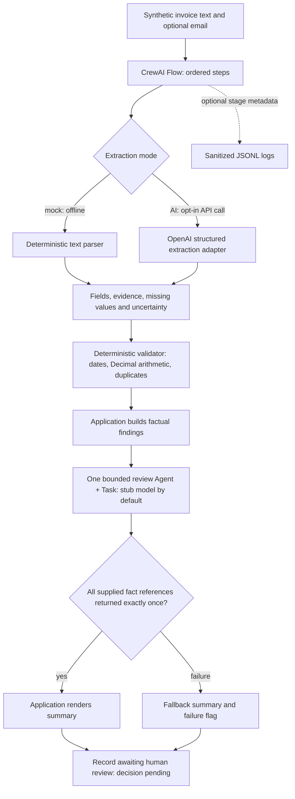

# AI Operations Agent

A Python workflow that turns **synthetic invoice text into structured, checked,
reviewable records**. It preserves source evidence, flags missing or conflicting
information, and keeps every record pending human review.

The project demonstrates deterministic validation, optional AI extraction,
CrewAI orchestration, offline evaluation and structured logging. It currently
runs through a CLI; there is no approval UI, email sending or payment execution.

## Evidence at this checkpoint

| Measurement | Observed result |
|---|---:|
| Automated tests | 98 passed |
| Mock recovery of known fields | 131 / 140 — 93.57% |
| Cases passing every quality check | 16 / 17 |
| Cases passing every workflow-integrity check | 17 / 17 |
| Live-model extraction accuracy | Not evaluated |

The quality failure is retained: a valid invoice outside the mock parser's
supported grammar cannot be extracted, but its missing fields remain visible in
validation and review. The small synthetic dataset is not a representative
benchmark. [Methodology, denominators and measured report](evaluation/README.md).

## Architecture



The extractor reads; the validator checks; neither approves. The review agent
can return references to existing facts, not new invoice values or prose.
Application code renders the final summary. A deterministic formatting function
would be simpler for this job; the single agent demonstrates a bounded CrewAI
handoff rather than independent financial reasoning.

[Architecture and trade-offs](docs/architecture.md) ·
[Technical case study](docs/case-study.md) ·
[Implementation and AI configuration](docs/implementation.md)

## Quick start

Tested on Linux with Python 3.12 and CrewAI 1.15.30. Use Python >=3.12,<3.14.
The commands below use `uv` and run from the repository root:

```sh
uv venv .venv
uv pip sync --python .venv/bin/python --require-hashes requirements.lock
uv pip check --python .venv/bin/python
.venv/bin/python -m unittest discover -s tests -v
```

The hashed lockfile was resolved for Linux/Python 3.12. CrewAI brings a substantial
set of dependencies; no optional tool/provider extras are requested. Installation
needs package-registry access. The mock workflow, demo and tests run afterward
without API keys, paid calls, network access or a database.

Run one invoice:

```sh
.venv/bin/python -m operations_agent samples/invoice.txt --format text --mode mock --orchestrate --known-vendor 'Demo Supplies'
```

The JSON result includes extracted fields, evidence, validation errors, a review
summary and `human_decision: "pending"`. Exit 0 means the processing checks passed,
not approval. Exit 1 signals extraction/validation/workflow issues; exit 2 signals
invalid arguments or input. Baseline processing without CrewAI remains available
by omitting `--orchestrate`; see the implementation reference.

## Reproduce the demo and evaluation

```sh
.venv/bin/python scripts/demo.py
.venv/bin/python -m operations_agent.evaluation --output local-data/evaluation.json --log-json local-data/evaluation.jsonl
```

The guided demo checks three real workflow examples and the measured evaluation.
It exits 0 when they match this documented checkpoint; it does not relabel the
known extraction failure as a quality pass. Generated JSON results, the evaluation
report and stage logs are saved under ignored `local-data/portfolio-demo/`.
[Demo walkthrough and recording outline](docs/demo.md).

The standalone evaluation command currently exits **1** because one of its 17
cases fails quality checks. It still writes the full report. Known-field accuracy
and unresolved-field detection are scored separately; null ground truth cannot
inflate the known-field accuracy score. [Evaluation documentation](evaluation/README.md).

## AI mode and limitations

AI extraction is optional and may incur provider charges. Configure
`INVOICE_AI_API_KEY` (or `OPENAI_API_KEY`) and `INVOICE_AI_MODEL` securely in the
process environment, then explicitly select `--mode ai`. It needs HTTPS access
to `api.openai.com` and a model supporting Responses API strict JSON Schema.
Do not put credentials in source files or chat. `.env` files are not automatically
loaded. The review agent remains a stub in both CLI modes.
[Configuration and API contracts](docs/implementation.md#optional-ai-mode).

- All demonstrations and evaluation data are synthetic. No real inbox, accounting
  service, vendor account or payment system is connected.
- Mock extraction supports labels and a narrow set of sentences. AI quality is
  unmeasured; source evidence does not guarantee correct interpretation.
- PDF, OCR, scanned-image and attachment processing are unsupported.
- Duplicate history lasts for one validator instance. Currency support is limited
  to USD/EUR/GBP/INR; money supports nonnegative values up to one trillion and two
  stored decimal places. Credit notes and currency-specific precision are future work.
- There is no approval UI, persistent application storage or approved export.
- The CrewAI adapter is version-pinned and includes a documented private-path
  compatibility override. The synchronous wrapper changes process-wide settings;
  it is intended for serial CLI use, not a concurrent server.

## Find the code

| Responsibility | Location |
|---|---|
| Invoice schema and deterministic rules | [validation.py](operations_agent/validation.py) |
| Mock and AI extraction | [extraction.py](operations_agent/extraction.py), [ai_extraction.py](operations_agent/ai_extraction.py) |
| CrewAI Flow and bounded review task | [orchestration.py](operations_agent/orchestration.py) |
| Sanitized stage logging | [observability.py](operations_agent/observability.py) |
| Scoring and ground truth | [evaluation.py](operations_agent/evaluation.py), [dataset.json](evaluation/dataset.json) |
| Regression tests and fixtures | [tests/](tests/) |

Next work should validate a configured live extractor on broader independent
synthetic data, then add explicit human review and approved exports. More agents
are not needed to explain or demonstrate the current engineering decisions.

Cloud publication and restoration are separate from these software checks.
[Preserve the cloud environment and verify reopening](docs/cloud-preservation.md);
a saved draft or a pushed Git branch does not establish snapshot publication.
